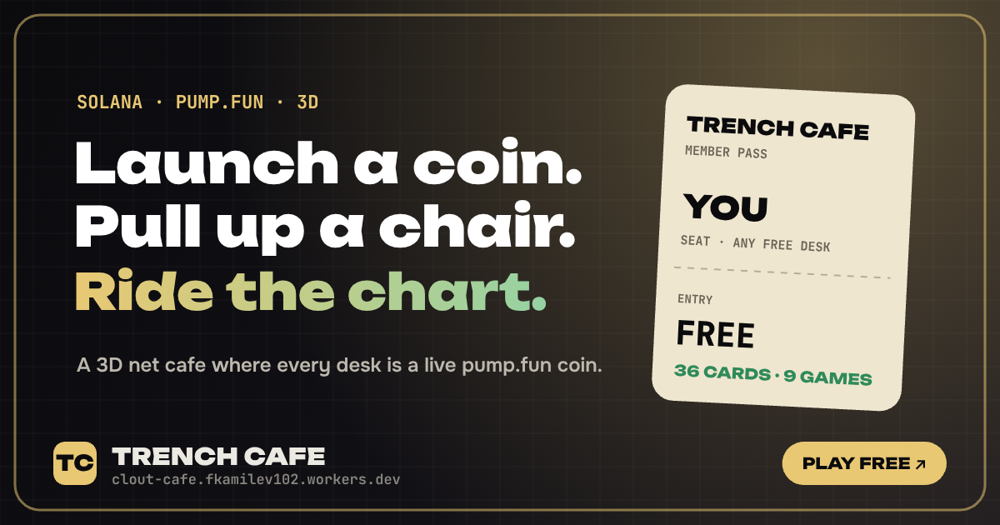

# Trench Cafe

**A 3D multiplayer net cafe in the Solana trenches.** Every desk is a live [pump.fun](https://pump.fun) coin: sit down, launch a real token in about a minute, and let the whole lobby watch your chart. Walk around a small night town with a casino, a ranked arcade, a weekly league, hidden Solana history cards, a bartender who hands out daily tasks, and a big board of the week's best launches, runs and recruiters.

Live: **https://clout-cafe.fkamilev102.workers.dev**



---

## What's inside

| | |
|---|---|
| **Real launches** | Name, ticker, picture, socials → a real pump.fun coin, created by the server and seated at a desk for everyone in real time. Live trades, market cap and charts on every desk monitor and the big screen. |
| **Multiplayer** | Everyone online shares one room: avatars, chat bubbles, emotes, megaphone shouts, live feeds. One Cloudflare Durable Object holds the state. |
| **Characters** | 15 block characters plus a full editor (body, build, hair, eyes, outfit, colours, accessories, emotes, a photo face, three chat phrases). |
| **Chip economy** | A play currency for the casino, ranked arcade, the league, boosts, desk plates, cosmetics, the megaphone and a double-XP espresso. Earned through a daily streak, daily tasks, crates, cards, royalties and invites. Chips never turn back into SOL. |
| **Ranked arcade** | Six skill games (Rug Radar, Degen Math, Address Lock, Chart Eye, Ticker Sprint, Quant Sprint). Runs are issued and scored by the server; weekly and all-time boards. |
| **Trench League** | Every coin launched here is in a weekly league. Back coins with chips; the highest peak market cap of the week wins the pool. |
| **Exploration** | 36 Solana story cards with their own art, daily chip crates, green candles, a card album with rarities. |
| **Progression** | Levels and titles, XP from everything, a daily tracker, a minimap, a hotbar. |
| **Buyback** | A share of the cafe's income buys the main token back on the open market from a dedicated wallet, in small randomised buys, then burns it. Every buy is shown in town with a Solscan link. |
| **Social** | Invite pass with a personal link, share-to-X pictures generated in the browser, a weekly board in the town square, a generative lo-fi soundtrack with room ambience. |
| **Five languages** | English, 中文, 日本語, 한국어, Español. |

## How it works

```
 browser  ──HTTPS──▶  Cloudflare Worker  ──▶  static page (public/index.html)
    │                        │
    └────── WebSocket ──────▶ Durable Object "Cafe"  ── Solana RPC / PumpPortal / price feeds
                             (room state, chat, launches, chips, boards, storage)
```

* **One page, no CDN.** The whole game (three.js, fonts, styles, code) is bundled into a single `public/index.html` by `scripts/build.mjs`.
* **One room.** `src/index.js` defines the Worker and the `Cafe` Durable Object. Feature modules install themselves onto it: `extras.js` (shop, chips, casino), `arcade.js`, `hunt.js`, `league.js`, `ref.js` (invite pass), `bank.js` (chip bank).
* **Shared rules.** `src/arcade-games.js` and `src/hunt-data.js` are imported by the server and also compiled into the browser bundle, so both sides agree on runs and crate spots.
* **Wallet sign-in** is a signed message in Phantom: no transaction and no fee. Payments are ordinary SOL transfers that the server verifies on chain before it acts.

More detail: [docs/ARCHITECTURE.md](docs/ARCHITECTURE.md) and [docs/API.md](docs/API.md).

## Project layout

```
client/
  shell.html            page markup and all styles
  src/                  the game, as ordered modules sharing one scope (see scripts/sources.mjs)
    00-core.js          renderer, scene, post-processing, base strings, helpers
    01-i18n.js          translations
    02-characters.js    block characters and the editor's parts
    03-world.js         cafe room, desks, town, places
    04-world-details.js props, machines, big screen, scenery
    05-easter-eggs.js   Solana story cards and their art
    06-game.js          avatars, movement, camera, proximity, NPCs
    07-ui.js            landing, character select, panels, launch wizard, world screens
    08-minigames.js     free mini-games
    09-casino.js        chips casino
    10-arcade.js        ranked arcade
    11-hunt.js          crates and candles
    12-league.js        Trench League
    13-net.js           multiplayer socket, wallet, payments
    14-shop.js          cosmetics
    15-hud.js           level, XP, minimap, hotbar, card album
    16-social.js        bartender, music, invite pass, share to X, weekly board
    17-bank.js          chip bank
src/                    Cloudflare Worker + Durable Object (server)
scripts/                build and checks
test/                   unit tests for the shared rules and the chip bank
public/                 built page + link preview image (served as static assets)
docs/                   architecture and API notes
```

## Run it locally

Requirements: Node.js 18+.

```bash
npm install
npm run build          # client/ → public/index.html (+ dist/standalone.html)
npm run dev            # wrangler dev: page + room on http://localhost:8787
```

Without a server key the room runs in **test mode**: multiplayer, chat, the editor, chips and games all work, launches are simulated and visible only to the player who made them.

```bash
npm test               # unit tests
npm run check          # unit tests + translation check
```

`dist/standalone.html` opens straight from disk: a single-player preview with no server.

## Deploy

The repository is connected to Cloudflare Workers Builds: every push to `main` deploys. By hand:

```bash
npx wrangler login
npm run build
npm run deploy
```

### Going live

Real launches need two secrets (never commit them):

```bash
npx wrangler secret put OWNER_SECRET_KEY   # base58 key of a fresh hot wallet used by the server
npx wrangler secret put RPC_URL            # a mainnet RPC URL, e.g. Helius
npx wrangler secret put BUYBACK_SECRET_KEY # optional: a separate wallet used only by the buyback robot
```

Check `https://<your-site>/api/health` for `"live": true`. For local runs, copy `.dev.vars.example` to `.dev.vars`.

### Configuration (`wrangler.jsonc` → `vars`)

| Variable | Meaning |
|---|---|
| `LAUNCH_FEE_SOL` | price of a launch |
| `VIP_FEE_SOL`, `VIP_DESK_SOL` | VIP pass, VIP desk at launch |
| `BOOST_FEE_SOL`, `BOOST_MINUTES` | big-screen boost price and length (also payable in chips) |
| `PLATE_SOL` | desk name plate (also payable in chips) |
| `ARCADE_RUN_SOL`, `ARCADE_RUN_CHIPS` | price of a ranked arcade run |
| `CHIP_PACKS` | chip packs: USD price → chips |
| `DEV_BUY_SOL` | optional first buy made by the server at launch |
| `PAY_TOKEN_MINT` | optional SPL token accepted in the shop |
| `PAYOUT_WALLET`, `RESERVE_SOL` | treasury address for the scheduled sweep and the hot-wallet reserve |
| `LAUNCHES_PER_HOUR_PER_IP` | launch rate limit |
| `PHOTO_MAX_KB` | max size of an uploaded face photo |
| `BUYBACK_WALLET` | public address of the buyback wallet; the `BUYBACK_SECRET_KEY` secret must belong to it |
| `BUYBACK_MINT` | the main token bought back; empty = buyback off |
| `BUYBACK_SHARE` | share of the swept income sent to the buyback wallet (0 to 1) |
| `BUYBACK_MODE` | `burn` the bought tokens or `hold` them in the buyback wallet |
| `BUYBACK_FROM` | `all` = creator fees and site payments, `fees` = creator fees only |
| `BUYBACK_MAX_SOL`, `BUYBACK_SLIPPAGE` | cap per buy, max slippage in percent |

`SITE_URL` (environment variable for `npm run build`) sets the absolute address used in link previews.

## Notes on chips

Chips are a closed play currency. They are bought in packs or earned in game, and spent in game. There is no way to withdraw, sell or transfer them, and the casino pays out in chips only.

## Tech

[three.js](https://threejs.org) · [esbuild](https://esbuild.github.io) · [Cloudflare Workers + Durable Objects](https://developers.cloudflare.com/durable-objects/) · [@solana/web3.js](https://solana-labs.github.io/solana-web3.js/) · [PumpPortal](https://pumpportal.fun) · WebAudio · Canvas 2D
